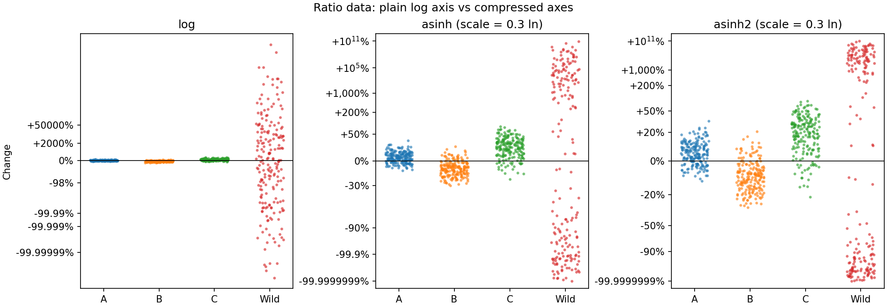
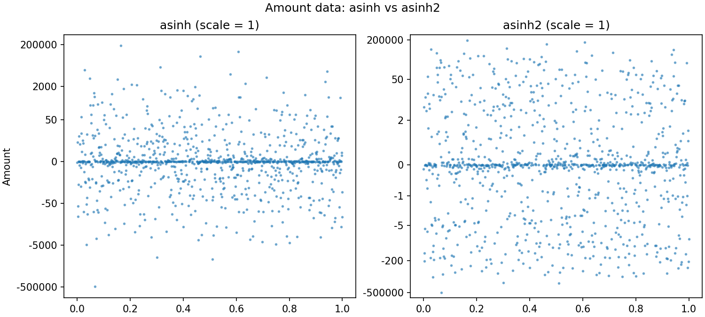

# axis-scales

Tick marks and axis bounds for **compressed plot axes**: axes that stay linear
near zero but squeeze the tails, so that small changes and enormous ones can be
read on the same plot. Built for matplotlib, with only numpy and matplotlib as
dependencies.

It handles two kinds of data:

- **Ratios** (1.0 = no change), labeled as percent change. A ratio axis can run
  from -99.99999% to +10¹²% while ±20% still gets a readable share of it.
- **Amounts** (positive, negative or zero), labeled with the amounts themselves.

For each kind there are two compressed scales, **asinh** and **asinh2**,
alongside plain log (ratios) and linear axes.



*The same ratio data on three axes. On the plain log axis (left), groups A, B
and C, which differ by tens of percent, are squashed into a line by the "Wild"
group, which spans 18 orders of magnitude. asinh (middle) and asinh2 (right)
keep the interesting range readable and still show every point.*

## Install

```bash
pip install git+https://github.com/Sustainable-Solutions-Lab/axis-scales.git
```

or, in a `requirements.txt`:

```
axis-scales @ git+https://github.com/Sustainable-Solutions-Lab/axis-scales.git
```

To pin a version, so that figures stay reproducible, append `@<tag or commit>`
to the URL. To edit the library while using it, clone it and run
`pip install -e path/to/axis-scales`.

Then import from `axis_scales`:

```python
from axis_scales import get_axis_bounds_and_ticks_ratio_compressed, ratio_axis_transform
```

## Quick start

A ratio axis compressed with asinh2:

```python
import numpy as np
import matplotlib.pyplot as plt
from axis_scales import get_axis_bounds_and_ticks_ratio_compressed, ratio_axis_transform

x = np.arange(200)
ratios = np.exp(np.random.default_rng(0).normal(0, 4, x.size))   # ratio data, 1.0 = no change
scale, kind = 0.3, 'asinh2'

fig, ax = plt.subplots()
ax.scatter(x, ratio_axis_transform(np.log(ratios), scale, kind), s=4)   # plot TRANSFORMED values
bounds, ticks, labels = get_axis_bounds_and_ticks_ratio_compressed(ratios, scale, kind)
ax.set_ylim(bounds)
ax.set_yticks(ticks)
ax.set_yticklabels(labels)        # labels are strings such as '-99.999%', '+50%', '$+10^{6}\%$'
ax.axhline(0, color='k', lw=0.8)  # 0 maps to 0, so the "no change" line needs no transform
```

The pattern is the same for every axis type in this package. You transform the
data yourself and plot the transformed values, so the y-axis runs in
transformed units. A `get_axis_bounds_and_ticks_*` function then supplies the
limits, the tick positions (in transformed units) and the labels (in original
units).

## The scales

### Definitions

Let `z` be the quantity being compressed and `s > 0` the `scale`:

| `kind` | Forward: plotted value `u` | Inverse | Near 0 | Tails grow like |
|--------|----------------------------|---------|--------|-----------------|
| `'asinh'`  | `u = asinh(z / s)`        | `z = s · sinh(u)`       | `u ≈ z / s` | `ln |z|` |
| `'asinh2'` | `u = asinh(asinh(z / s))` | `z = s · sinh(sinh(u))` | `u ≈ z / s` | `ln ln |z|` |

`asinh(x) = ln(x + √(x² + 1))` is linear for `|x| ≪ 1` and behaves like
`sign(x) · ln(2|x|)` for `|x| ≫ 1`. Both transforms are therefore odd (`−z` maps
to `−u`), smooth, defined for every real `z` including zero and negatives, and
linear with slope `1/s` across `±s`. Beyond `±s`, asinh compresses
logarithmically and asinh2 compresses doubly logarithmically.

Unlike matplotlib's `symlog`, which joins a linear piece to two log pieces,
these transforms have no kink where the regimes meet.

### What `z` is

- **Amounts:** `z` is the amount itself.
- **Ratios:** `z = ln(ratio)`, the natural-log ratio, **not** the percent
  change. Percent change is bounded below at -100% and unbounded above, so
  compressing it directly would give a lopsided axis. The log ratio is
  symmetric: doubling (+100%) and halving (-50%) sit at `±ln 2`. With
  `kind='log'`, ratio axes plot `z` itself with no compression.

### Choosing `kind`

- `'log'` (ratios only): data spans no more than a few orders of magnitude.
- `'asinh'`: the tails run a few orders of magnitude past the interesting range.
- `'asinh2'`: the tails run *many* orders of magnitude past it (e.g. -99.99999%
  to +10¹²%). It gives the region around `±s` a much larger share of the axis.

### Choosing `scale`

`scale` sets where the axis stops being linear: values well inside `±scale` are
spaced almost evenly, and values beyond it are compressed.

- **Ratios:** `scale` is in log-ratio units. `0.3` is a good default: either
  kind then stays within about 4% of linear across ±10%, and the transition
  happens around +35% / -26% (`e^±0.3`).
- **Amounts:** `scale` is in the data's units. A practical choice is a
  percentile of the magnitudes, e.g.
  `scale = np.percentile(np.abs(data), 97.5)` keeps about 95% of the data in
  the near-linear region.

### Tick placement

Ticks are drawn from ladders of "nice" values: 1, 2, 5 × 10ⁿ for amounts and
percent increases, and -90%, -99%, -99.9%, … for collapses. For compressed axes
(both kinds for ratios; `asinh2` for amounts) the outermost tick is the first
nice value at or beyond the data, and `padding` adds only a small margin
beyond it. The fractional padding used for linear and log axes would, far out
on a compressed axis, push the outer tick orders of magnitude past the data.



## For AI coding assistants

This section is for an AI assistant (Claude Code, Codex, Cursor, …) asked to
use these scales in another project. People may find it useful too. A user
might write:

> Read the README at https://github.com/Sustainable-Solutions-Lab/axis-scales
> and put the y-axis of the figures in `plot_results.py` on an asinh2 ratio
> scale.

How to integrate:

1. **Prefer installing over copying.** Add
   `axis-scales @ git+https://github.com/Sustainable-Solutions-Lab/axis-scales.git`
   to the project's dependencies and import from `axis_scales`. If the project
   can't take a git dependency, copy the whole `axis_scales/` folder into it
   and keep its `LICENSE` notice. Its modules import each other relatively.
2. **Do not reimplement the tick logic.** The transforms are one line each,
   but the tick ladders, the label formatting (e.g. `-99.99999%`,
   `$+10^{12}\%$`) and the padding rules carry subtle decisions. Call
   `get_axis_bounds_and_ticks_ratio_compressed`,
   `get_axis_bounds_and_ticks_ratio_pct` or `get_axis_bounds_and_ticks_arcsinh`.
   Only for a non-matplotlib or non-Python target (plotly, ggplot, JavaScript),
   port the transforms from the table above and port the tick code from
   `axis_scales/` rather than inventing a new tick scheme.
3. **Transform the data and plot the transformed values.** Do not use
   `ax.set_yscale(...)` with these functions: the returned ticks and bounds are
   in transformed units. Everything else drawn on the axis must be transformed
   the same way: reference lines, shaded bands, annotations, error bars. For
   ratios, that means `ratio_axis_transform(np.log(r), scale, kind)`. For
   amounts, `amount_to_arcsinh(a, scale, kind)`.
4. **Ratios: compress `ln(ratio)`, never the percent change.** If the data is
   given as percent change `p`, convert it with `ratio = 1 + p/100`.
5. **Set the labels from the returned strings.** Compressed-ratio labels come
   back as strings (some are LaTeX), because ticks such as
   `-(100 − 10⁻²⁰)%` can't be stored as a float. For a `kind='log'` ratio axis,
   format the returned percents with `format_percent`, not `f'{p:g}%'`, which
   keeps only six significant digits and turns -99.99999% into -100%.
6. **Use the same `scale` and `kind`** for the data, the ticks and every other
   element on the axis. When several panels must be compared, give them the
   same `scale`, and pass the combined data range so they share limits.
7. **Diverging colormaps:** for a colorbar on a compressed axis, pass
   `symmetric=True` so the limits are symmetric about 0 and the colormap's
   midpoint sits at 0%.
8. The ready-made `plot_*` functions below are conveniences for quick line and
   band plots. For anything else, use the `get_axis_bounds_and_ticks_*`
   functions with the project's own plotting code.

## Which function for which data

| Data | Ticks and bounds | Transform the data with | Ready-made plots |
|------|------------------|-------------------------|------------------|
| Linear | `get_axis_bounds_and_ticks` | nothing | — |
| Ratios, few orders of magnitude | `get_axis_bounds_and_ticks_ratio_pct` | `np.log(r)` | `plot_ratios`, `plot_ratios_shaded` |
| Ratios, huge range | `get_axis_bounds_and_ticks_ratio_compressed(..., kind='asinh' or 'asinh2')` | `ratio_axis_transform(np.log(r), scale, kind)` | `plot_ratios(..., kind=..., scale=...)`, `plot_ratios_shaded(...)` |
| Amounts (pos/neg/zero) | `get_axis_bounds_and_ticks_arcsinh(..., kind='asinh' or 'asinh2')` | `amount_to_arcsinh(a, scale, kind)` | `plot_amounts_arcsinh`, `plot_amounts_shaded_arcsinh` |

The inverses are `ratio_axis_inverse`, `arcsinh_to_amount` and, at the lowest
level, `asinh_transform` / `asinh_inverse`.

## API reference

### `get_axis_bounds_and_ticks_ratio_compressed(data, scale, kind='asinh', padding=0.03, symmetric=False, n_ticks=9, min_exponent=0)`

For ratio data spanning more range than a plain log axis can show. Takes raw
ratios and returns `(bounds, ticks, labels)`: bounds and ticks in transformed
units, and labels as strings. Very deep collapses and very large increases are
written in powers of ten.

```python
bounds, ticks, labels = get_axis_bounds_and_ticks_ratio_compressed([1e-7, 1e10], scale=0.3, kind='asinh2')
# labels: ['-99.99999%', '-90%', '-50%', '-20%', '0%', '+20%', '+50%', '+200%', '$+10^{4}\\%$', '$+10^{12}\\%$']
```

- `padding` is a margin beyond the outermost ticks, which already sit at or beyond the data.
- `symmetric=True` makes the limits symmetric about 0.
- `n_ticks` is the target number of ticks.
- `min_exponent=-1` (or lower) adds sub-percent ticks (±0.1%, ±0.2%, ±0.5%) for data well inside ±1%.
- The lower-level `choose_compressed_ratio_ticks(zmin, zmax, scale, kind)` takes the data range as log ratios.

### `get_axis_bounds_and_ticks_ratio_pct(data, padding=0.0, symmetric=False, buffer=0.05)`

For ratio data (1.0 = no change, 2.0 = +100%, 0.5 = -50%) on a plain log axis.
Returns `(bounds, ticks, pct_labels)`: bounds and ticks in `ln(ratio)` units,
and the tick values as float percents.

```python
from axis_scales import get_axis_bounds_and_ticks_ratio_pct, format_percent

bounds, ticks, pcts = get_axis_bounds_and_ticks_ratio_pct([0.5, 3.0])
ax.plot(x, np.log(ratios))
ax.set_ylim(bounds)
ax.set_yticks(ticks)
ax.set_yticklabels([format_percent(p) for p in pcts])
```

### `get_axis_bounds_and_ticks_arcsinh(data, scale, padding=0.0, symmetric=False, buffer=0.05, kind='asinh')`

For amount data (positive, negative or zero). Returns
`(bounds, ticks, amount_labels)`: bounds and ticks in transformed units, and
the tick values as floats.

```python
from axis_scales import get_axis_bounds_and_ticks_arcsinh, amount_to_arcsinh

bounds, ticks, amounts = get_axis_bounds_and_ticks_arcsinh([-5, 100], scale=2, kind='asinh2')
ax.plot(x, amount_to_arcsinh(values, 2, 'asinh2'))
ax.set_ylim(bounds)
ax.set_yticks(ticks)
ax.set_yticklabels([f'{a:g}' for a in amounts])
```

### `get_axis_bounds_and_ticks(data, padding=0.0)`

For linear axes: returns `(bounds, ticks)` with "nice" round tick spacing,
anchored at zero when the range spans zero.

### `plot_ratios(x_data, ratio_data, x_axis_label, y_axis_label, title, padding=0.05, colors=None, kind='log', scale=None)`

Plots each column of `ratio_data` (ratios, 1.0 = no change) as a line on a
ratio axis labeled in percent change. `kind` is `'log'`, `'asinh'` or
`'asinh2'`; the compressed kinds need `scale` (in log-ratio units). `colors`
is an optional list of matplotlib colors, one per column. Returns `(fig, ax)`.

```python
fig, ax = plot_ratios(x, ratios, x_axis_label='Year', y_axis_label='Change',
                      title='Two series', kind='asinh2', scale=0.3)
```

### `plot_ratios_shaded(x_data, ratio_data, ..., color=None, kind='log', scale=None)`

Plots ratio data with shaded uncertainty bands, in a single color. The number
of columns sets the style:

| Columns | Rendering |
|---------|-----------|
| 1 | Solid line |
| 3 | Shaded band + median line |
| 5 | Two nested bands (lighter outer, darker inner) + median line |
| 7 | Two nested bands + thin outer lines + median line |

### `plot_amounts_arcsinh(x_data, amount_data, scale, ..., colors=None, kind='asinh')` and `plot_amounts_shaded_arcsinh(x_data, amount_data, scale, ..., color=None, kind='asinh')`

The amount-data counterparts of `plot_ratios` and `plot_ratios_shaded`, on an
asinh or asinh2 axis.

## Examples

Run these from the repository root:

- `examples/demo_compressed_axes.py`: log vs asinh vs asinh2 for ratios, and
  asinh vs asinh2 for amounts. Writes the two figures in `docs/`.
- `examples/demo_plot.py`, `examples/demo_plot_shaded.py`: `plot_ratios` and
  `plot_ratios_shaded` with 1, 3, 5 and 7 columns. Write to `plots/`.
- `examples/demo_arcsinh_scatterplot.py`: an asinh scatter plot of amounts.
  Writes to `plots/`.

## License

MIT. See [LICENSE](LICENSE).
